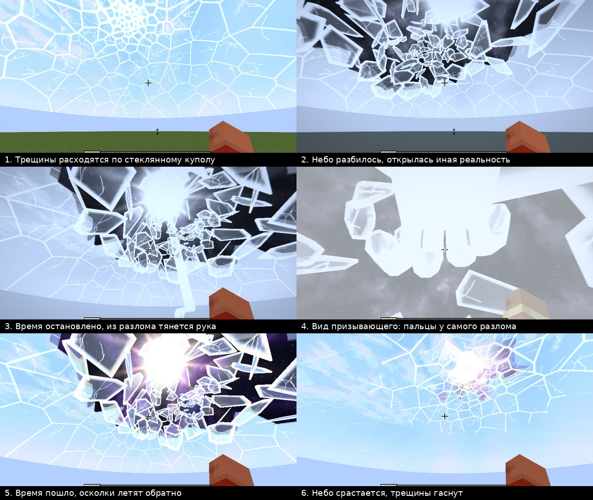

# Spawn Admin: Heavenly Summoning

Мод для **Minecraft 1.21.1 / NeoForge 21.1 / Java 21**.

Направь **Рог Небес** на игрока и протруби. 10 секунд ничего не происходит, только ты слышишь
тиканье часов. Потом небо перед жертвой начинает продавливаться внутрь: стекло прогибается,
искажает облака и скрипит под нагрузкой. Резкий щелчок, звезда трещин, и через всё небо
пробегает огромный раскол: небо раскалывается пополам. Трещины расходятся, половины неба
расходятся, сквозь раскол пробивается свет, вылетают сколы, первые осколки, и с грохотом
обрушивается купол. Осколки неба падают в сам мир, на блоки, и разлетаются стеклянной крошкой
(без урона и разрушений). Время останавливается, из сияющего разлома выходит огромная рука.
Жертва может бегать, рука догонит её где угодно в пределах 200 блоков, схватит и унесёт на
яркий остров в измерении администратора. Затем небо собирается обратно.



## Сборка

```bash
./gradlew build            # мод: build/libs/spawnadmin-0.1.0.jar, заодно прогоняются JUnit-тесты
./gradlew runClient        # клиент для разработки
./gradlew runServer        # выделенный сервер (папка run-server/)
./gradlew runGameTestServer  # игровые тесты серверной логики
```

Готовый jar кладётся в папку `mods/` клиента и сервера. Мод нужен на обеих сторонах: на
сервере он управляет событием, на клиенте рисует его. Игроки без мода могут зайти на сервер,
но эффекта не увидят.

## Как пользоваться

| Действие | Что происходит |
|---|---|
| ПКМ Рогом Небес, глядя на игрока | похищение этого игрока: 10 с тишины, затем вся сцена (кулдаун 60 с) |
| ПКМ Рогом Небес, не глядя ни на кого | то же для самого трубящего |
| `/heaven enter [игроки]` | похищение сразу, без 10 с тишины, но с полной анимацией |
| ПКМ Рогом в измерении администратора | возврат туда, откуда пришёл |
| `/heaven exit [игроки]` | вернуться в сохранённую точку |
| `/heaven return <игрок>` | выгнать игрока из измерения туда, где его забрала рука (по имени) |
| `/heaven cancel [игроки]` | прервать событие: игрок остаётся на месте, небо восстанавливается |

Пока идёт событие, у жертвы скрыт весь интерфейс: хотбар, здоровье, прицел, рука с
предметом, чат и надписи. Видно только небо. Интерфейс возвращается после прибытия в измерение.

В измерение администратора можно попасть **только через анимацию**: мгновенного телепорта нет
ни у рога, ни у команд. Пропустить анимацию нельзя. Цель заморожена, а переход происходит
только в конце подъёма рукой. Если цель выйдет из игры или погибнет до этого момента, перехода
не будет, и небо просто соберётся обратно.

Команды требуют уровня прав 2 (оператор). Рог лежит во вкладках «Инструменты» и
«Блоки оператора» творческого режима.

## Настройки

`world/serverconfig/spawnadmin-server.toml`:

| Ключ | По умолчанию | Смысл |
|---|---|---|
| `hiddenDelaySeconds` | 10 | тишина между звуком рога и свечением неба |
| `hornCooldownSeconds` | 60 | кулдаун рога |
| `maxEventsPerDimension` | 3 | сколько событий одновременно в одном измерении |
| `targetDimension` | `spawnadmin:admin_realm` | куда рука уносит игрока |
| `buildArrivalPlatform` | true | строить платформу в точке прибытия |

## Как это устроено

Подробный план и решения описаны в [docs/PLAN.md](docs/PLAN.md).

* **Сервер управляет только состоянием.** `SkyEventManager` ведёт скрытое ожидание, фазы,
  фиксацию цели, перенос, отмену и синхронизацию для зашедших позже. На всё событие уходит
  несколько маленьких пакетов: seed, тик старта, позиция фиксации, тик восстановления.
* **Клиенты детерминированно строят сцену из seed.** Поэтому все наблюдатели видят одно и то же.
  Никаких Entity, никаких изменений блоков и настоящего неба.
* **Геометрия** (`sky/geom`, чистая Java, покрыта JUnit):
  * купол как сферическая шапка радиусом 110 блоков;
  * разлом как у настоящего стекла: радиальные трещины от точки удара, поперечные трещины
    Вороного и дополнительные разрезы на острые вытянутые осколки, около 500 штук, плюс крошка;
  * сетка топологическая и цельная: у каждого шва есть трещина;
  * каждый осколок уникален: швы между кусками не прямые, а рваные (зигзаг со своим шагом и
    амплитудой из seed, общий для обоих соседей), поэтому двух одинаковых контуров нет;
  * трещины распространяются по Дейкстре (радиальные быстрее поперечных), есть волосяные ответвления.
* **Небо на стекле**: каждый осколок несёт кусок настоящего неба Minecraft (цвет и облака
  из текстуры игры), целый купол сливается с небом.
* **Анимация** (`SkyScene`): у каждого осколка своя траектория, вращение, режим (падает или
  зависает) и окно восстановления. Обратная сборка стартует со снимка состояния на момент
  остановки времени: разворот, полёт по дуге, стыковка со вспышкой края, затем гаснут трещины
  и свечение.
* **Рука** (`HandRig`): процедурная модель из ладони, 5 пальцев по 3 фаланги и предплечья.
  Траектория руки и позиция переносимого игрока считаются из одних данных.
* **Шейдеры**: стекло (преломление по копии кадра, дисперсия, френель, блики, свечение кромки),
  трещины, иная реальность, энергия руки, остановка времени. У каждого осколка своя поверхность:
  оттенок, царапины, волнистость стекла, «гребень» скола у кромки, пузырьки, блик по своей оси.
* **VFX**: кольцо ударной волны в момент щелчка, вспышка экрана при обрушении (рядом с разломом),
  пыль и хруст там, где крупные осколки ложатся на блоки.
* **Очистка ресурсов.** Копия кадра создаётся только во время события и освобождается, когда
  событий нет, при выходе из мира и при смене размера окна.

## Тесты

* `./gradlew test`: 25 JUnit-тестов геометрии и анимации. Проверяются детерминированность,
  покрытие купола осколками, симметрия соседства, полнота трещин, непрерывность и точность
  восстановления, путь руки.
* `./gradlew runGameTestServer`: 6 игровых тестов. Рог (тишина и кулдаун), полный цикл с переносом
  и возвратом, отмена с восстановлением, вход и выход из измерения.
* Мультиплеер: `./gradlew runServer`, затем `./gradlew runClient -PautoJoin=localhost` и
  `./gradlew runClient2 -PautoJoin=localhost` (второй игрок, Observer). Командами на тестовом
  сервере можно управлять через `python3 tools/rcon.py "heaven enter Dev"`. Для этого включите
  RCON в `run-server/server.properties`: `enable-rcon=true`, `rcon.password=heaven`.

## Звук и музыка

| Момент | Звук |
|---|---|
| Звук рога | мистический рог |
| 10 с скрытого ожидания | тикают часы, раз в секунду, последние 3 секунды громче; слышит только тот, кто трубил, жертва ничего не знает |
| Продавливание | у трубившего три глухих удара башенных часов «час настал»; у всех: скрип и стон стекла под нагрузкой и начало саундтрека |
| Щелчок | резкий громкий треск стекла и звезда трещин |
| Трещины расходятся | 12 с нарастающего треска |
| Обрушение | грохот: низкий удар, раскаты и тысячи осколков; гул раскрывающегося разлома |
| Осколки падают на землю | хруст стекла о землю там, где упали крупные осколки |
| Рука | мощный низкий звук приближения, щелчки смыкающихся пальцев и тяжёлый удар захвата |
| Подъём и исчезновение | нарастающий рёв воздуха, светлая вспышка |
| Остановка времени | последний тик и глухой удар механизма, затем тишина; музыка тормозит, как плёнка |
| Всё событие | саундтрек на 33 с без колокольчиков: фортепиано, струнные, пиццикато, хор, барабаны. Фальшивящая мелодия на трещинах; внезапная тишина и обратный аккорд перед разломом; удар, бегущие вниз струнные и барабан 7/8 при падении; остановка «плёнки»; хор в далёкой тональности и сдвиг на полутон на захвате; бесконечно растущий тон при подъёме; мелодия задом наперёд при восстановлении |
| Измерение администратора | тихая медленная музыка: фортепиано и струнные (около 81 с, повторяется с паузами) |

Саундтрек и музыка измерения идут по категории «Музыка», ползунок громкости на них действует.
Во время события обычная музыка игры приглушается. Если событие отменить, саундтрек обрывается.

## Ассеты

Звуки разрушения стекла (`glass_snap`, `sky_crack`, `sky_shatter`, `glass_land1-3`,
`sky_restore`) собраны скриптом `tools/build_glass_sfx.py` из настоящих записей бьющегося стекла
(CC0, источники в `tools/sfx_sources/CREDITS.md`): слои, сдвиг высоты, нарезка по атакам,
реверс для сборки неба, плюс синтезированный низкий удар и гул.
Остальное синтезировано процедурно: `tools/synth_glass.py` (скрип продавливаемого стекла),
`tools/synth_sounds.py` (остальные эффекты) и `tools/synth_music.py` (часы, саундтрек, музыка
измерения). Текстура рога нарисована скриптом `tools/make_textures.py`.
